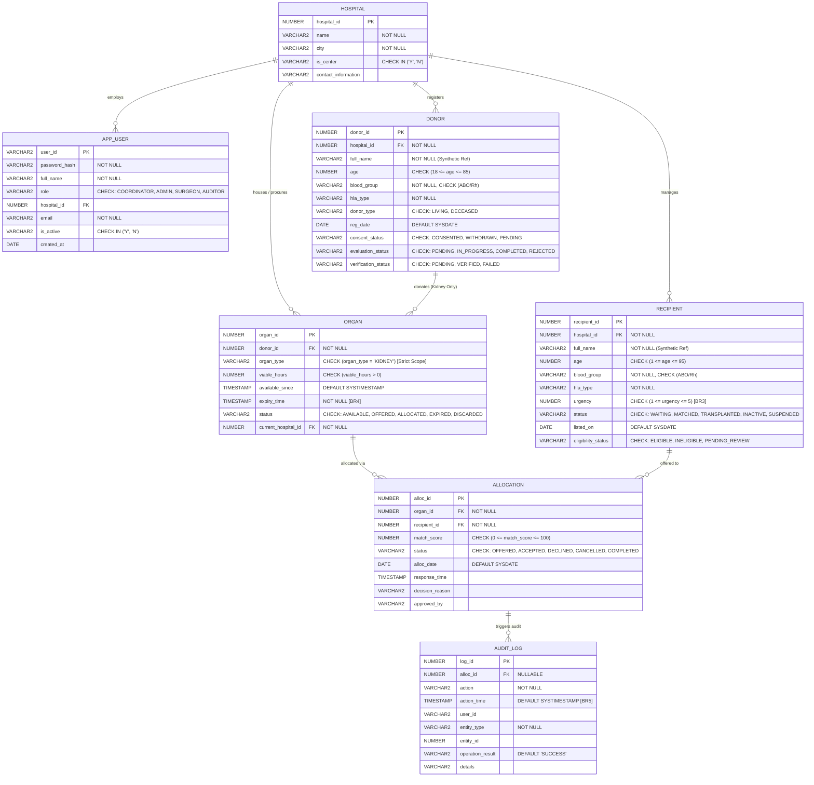

# VITAL — Entity-Relationship (ER) & Relational Schema Design

## 1. Executive Overview

**VITAL** (*Vital Information Transplant Allocation & Logistics*) is an ACID-compliant database system specifically scoped to **kidney transplantation**. The schema enforces clinical safety rules, prevents conflicting or duplicate allocations, and guarantees end-to-end auditability.

---

## 2. Mermaid Entity-Relationship Diagram

---

## 3. Resolving the Many-to-Many ($M:N$) Relationship

### Problem Definition:
In organ transplantation logistics:
- A procured **ORGAN (Kidney)** may potentially be evaluated and sequentially offered to **multiple candidate recipients** (if the first ranked candidate temporarily declines or fails clinical clearance).
- A **RECIPIENT** on the waiting list may, across their waitlist history, receive offers from **multiple kidneys** before finding a viable graft.

If modeled directly, this constitutes a Many-to-Many ($M:N$) relationship between `ORGAN` and `RECIPIENT`, which cannot be directly represented in relational database design without introducing severe data anomalies, null values, or repetitive repeating groups.

### Relational Solution:
The **`ALLOCATION`** entity functions as a first-class **Associative Entity (Bridge Table)**:
1. It decomposes the $M:N$ relationship into two clean $1:M$ relationships:
   - `ORGAN` ($1$) $\rightarrow$ `ALLOCATION` ($M$)
   - `RECIPIENT` ($1$) $\rightarrow$ `ALLOCATION` ($M$)
2. It encapsulates relationship attributes that belong neither solely to the organ nor solely to the recipient, including:
   - `match_score` (The computed compatibility score specific to this exact pair)
   - `status` (`OFFERED`, `ACCEPTED`, `DECLINED`, `CANCELLED`, `COMPLETED`)
   - `response_time` (When the clinical reviewer decided)
   - `decision_reason` (Clinical rationale for acceptance or declination)
   - `approved_by` (The authenticated reviewer identity)
3. Enforces **Business Rule 2 (No Duplicate Offers)** via composite unique constraint:
   $$\text{UNIQUE}(organ\_id, recipient\_id)$$
   This constraint ensures that the system can never generate redundant offers for the same kidney to the same recipient candidate.

---

## 4. Relational Schema & Integrity Constraints

| Table Name | Primary Key | Foreign Keys | Candidate / Unique Keys | Check Constraints |
|:---|:---|:---|:---|:---|
| **HOSPITAL** | `hospital_id` | *None* | `name, city` | `is_center IN ('Y', 'N')` |
| **APP_USER** | `user_id` | `hospital_id` $\rightarrow$ `HOSPITAL` | `email` | `role IN ('TRANSPLANT_COORDINATOR', 'HOSPITAL_ADMINISTRATOR', 'TRANSPLANT_SURGEON', 'REGULATOR_AUDITOR')`, `is_active IN ('Y', 'N')` |
| **DONOR** | `donor_id` | `hospital_id` $\rightarrow$ `HOSPITAL` | *None* | `age BETWEEN 18 AND 85`, `blood_group IN ('A+', 'A-', 'B+', 'B-', 'AB+', 'AB-', 'O+', 'O-')`, `donor_type IN ('LIVING', 'DECEASED')`, `consent_status IN ('CONSENTED', 'WITHDRAWN', 'PENDING')`, `evaluation_status IN ('PENDING', 'IN_PROGRESS', 'COMPLETED', 'REJECTED')`, `verification_status IN ('PENDING', 'VERIFIED', 'FAILED')` |
| **RECIPIENT** | `recipient_id` | `hospital_id` $\rightarrow$ `HOSPITAL` | *None* | `age BETWEEN 1 AND 95`, `blood_group IN ('A+', 'A-', 'B+', 'B-', 'AB+', 'AB-', 'O+', 'O-')`, `urgency BETWEEN 1 AND 5`, `status IN ('WAITING', 'MATCHED', 'TRANSPLANTED', 'INACTIVE', 'SUSPENDED')`, `eligibility_status IN ('ELIGIBLE', 'INELIGIBLE', 'PENDING_REVIEW')` |
| **ORGAN** | `organ_id` | `donor_id` $\rightarrow$ `DONOR`, `current_hospital_id` $\rightarrow$ `HOSPITAL` | *None* | `organ_type = 'KIDNEY'`, `viable_hours > 0`, `status IN ('AVAILABLE', 'OFFERED', 'ALLOCATED', 'EXPIRED', 'DISCARDED')` |
| **ALLOCATION** | `alloc_id` | `organ_id` $\rightarrow$ `ORGAN`, `recipient_id` $\rightarrow$ `RECIPIENT` | `(organ_id, recipient_id)` | `match_score BETWEEN 0 AND 100`, `status IN ('OFFERED', 'ACCEPTED', 'DECLINED', 'CANCELLED', 'COMPLETED')` |
| **AUDIT_LOG** | `log_id` | `alloc_id` $\rightarrow$ `ALLOCATION` (Nullable) | *None* | `action IS NOT NULL`, `operation_result IN ('SUCCESS', 'FAILURE', 'WARNING')` |

---

## 5. Normalization Justification

### First Normal Form (1NF):
- All attributes are atomic (single-valued); no composite or multivalued repeating groups exist.
- HLA types are formatted as standardized string representations (`A2-B7-DR4`) evaluated by deterministic compatibility functions.
- Every relation possesses a declared Primary Key.

### Second Normal Form (2NF):
- The schema is in 1NF.
- In every table with a composite candidate key (specifically `ALLOCATION` with `(organ_id, recipient_id)`), all non-prime attributes (`match_score`, `status`, `decision_reason`, `response_time`, `approved_by`) are **fully functionally dependent** on the whole key, not a partial subset. An offer status or match score is meaningless for an organ without a recipient or for a recipient without an organ.

### Third Normal Form (3NF):
- The schema is in 2NF.
- There are **no transitive dependencies** ($X \rightarrow Y$ and $Y \rightarrow Z$ where $Z$ is non-prime).
- Attributes such as `hospital_name` and `city` are not stored redundantly in `DONOR`, `RECIPIENT`, or `ORGAN`; rather, they are stored strictly in `HOSPITAL` and joined when queried.
- Organ cold ischemia expiry is tracked via `viable_hours` and `expiry_time` with active database triggers to guarantee state consistency without unnormalized derived anomalies.
